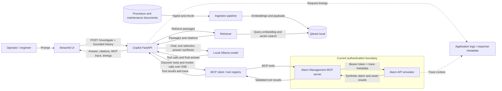

# Architecture

## System diagram

The diagram represents the current development prototype. The dashed
observability connections are limited: the backend returns per-stage timings,
and the simulator records trace context, but no centralized logging or metrics
service is configured.

## Components

| Component | Responsibility |
|---|---|
| Streamlit UI (`apps/frontend/app.py`) | Collects user prompts, forwards bounded conversation history, displays answer, source citations, tool trace, errors, and timing data. |
| Copilot API (`apps/backend/copilot.py`) | Retrieves procedure evidence, discovers MCP tools, asks Ollama to plan/invoke tools, handles partial failures, composes the response, and records stage timings. |
| MCP client / registry | Opens an SSE session to the MCP server, discovers tool schemas, invokes tools, and captures results/errors for the UI trace. |
| Alarm MCP server (`mcp-servers/alarm-management/server.py`) | Validates tool arguments and selected API response fields; owns HTTP auth, timeout/retry behavior, and simulator connection reuse. |
| Alarm API simulator (`apps/backend/simulator.py`) | Supplies synthetic asset/alarm records and filtered analytics through the documented HTTP contract. |
| RAG ingestion (`rag/ingestion/ingester.py`) | Reads supported text documents, chunks content, captures source metadata, generates embeddings, and persists Qdrant points. |
| Qdrant local | Stores vectors and source/chunk payloads in local persistent storage. The current mode is single-process, not a distributed database deployment. |
| Ollama | Runs the local generation model for tool planning and answer synthesis. Model choice and hardware affect quality and latency. |

## Request flow

1. The UI posts the query, feature toggles, and a bounded recent history to
   `/investigate`.
2. The backend retrieves up to five relevant document chunks on a worker
   thread. Retrieved passages are serialized as untrusted evidence with source
   metadata; empty/low-confidence retrieval is explicitly disclosed.
3. If MCP is enabled, the backend opens an SSE session and discovers the MCP
   tool schemas. Ollama selects tools; the backend invokes them through MCP,
   returns tool results to the model, and continues up to the configured tool
   round limit.
4. The MCP server sends authenticated HTTP requests to the simulator. The
   server validates inputs and selected outputs, retries configured transient
   failures, and raises failures for the MCP SDK to map.
5. The backend combines successful structured results and RAG evidence. If
   required MCP calls fail, it avoids asserting unverified live alarm facts.
6. The API returns answer text, confidence, citations, MCP call records, and
   stage timing data. The UI displays these along with degraded/error state.

## Ingestion and retrieval flow

The corpus is stored under `rag/documents/`. Run
`python -m rag.ingestion.ingester` to read, chunk, embed, and upsert documents
into the local Qdrant collection. At request time, the retriever embeds the
query, applies vector similarity and a relevance threshold, then returns chunk
content, score, and citation metadata. See [RAG design](rag-design.md) for
chunking, metadata, filtering, and citation details.

## Authentication and trust boundaries

- The simulator requires a bearer token for protected API operations. The
  token is configured by `ALARM_API_TOKEN`; the local demo fallback is not a
  production secret.
- The MCP connector adds the configured token to its API requests and forwards
  optional `trace_id`, `x-client-id`, and `x-metadata-tag` metadata.
- The current MCP SSE endpoint and copilot HTTP API do not authenticate
  individual end users. They should remain on a trusted local network.
- Retrieved documents and prior conversation messages are untrusted input.
  Their instructions cannot override the system prompt. No external
  write-capable operation is exposed by this workflow.
- Generated text and simulator actions are advisory sample content, not
  approved operating instructions.

## Observability and performance

The response `performance` object reports total request time, RAG retrieval,
MCP connection/discovery, tool durations, and Ollama call durations. The UI
renders the same values. The simulator logs request method/path/status and
trace/client metadata. These facilities help locate latency but do not provide
centralized log aggregation, metrics, tracing spans, alerting, or an audit
store.

## Deployment scope

Local development can run each Python service in a separate terminal. Docker
Compose is an optional repeatable setup and wires service health checks,
dependencies, token configuration, document storage, and local Qdrant
persistence. Compose and production deployment require environment-specific
validation. This repository does not include production-grade identity,
network, secret-management, scaling, or operational controls; see
[known limitations](known-limitations.md).

## Automated validation

Run `python -m pytest tests/unit tests/integration tests/mcp -v` to validate
the current local suite. The acceptance integration test uses the real
simulator and MCP tool handler with deterministic LLM/RAG fixtures; a full
browser-driven deployment test against Ollama and Compose is not currently
part of the automated suite.
